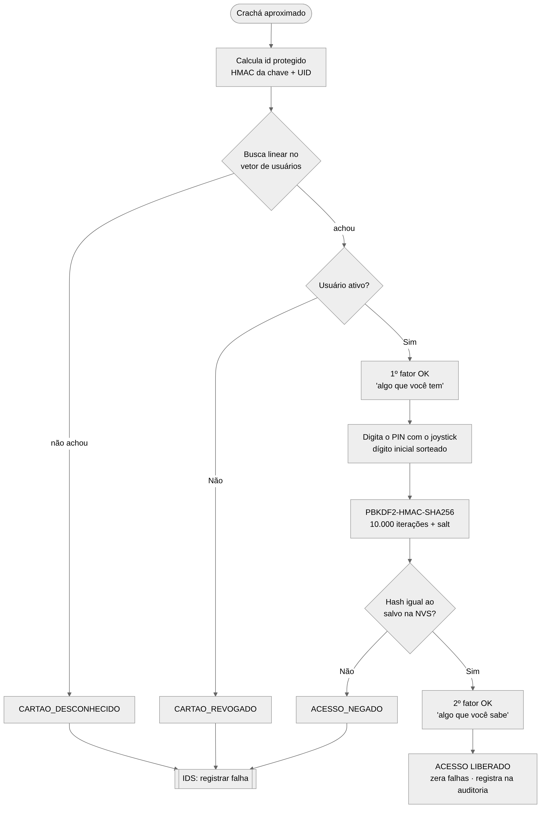
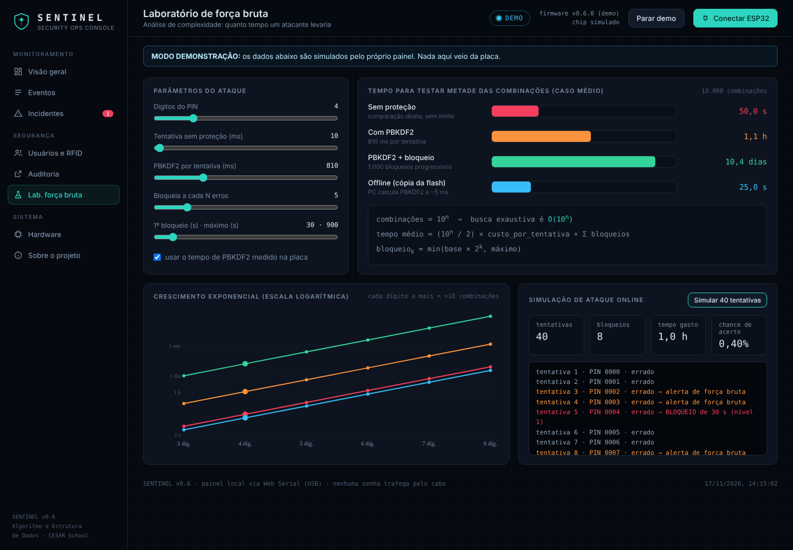
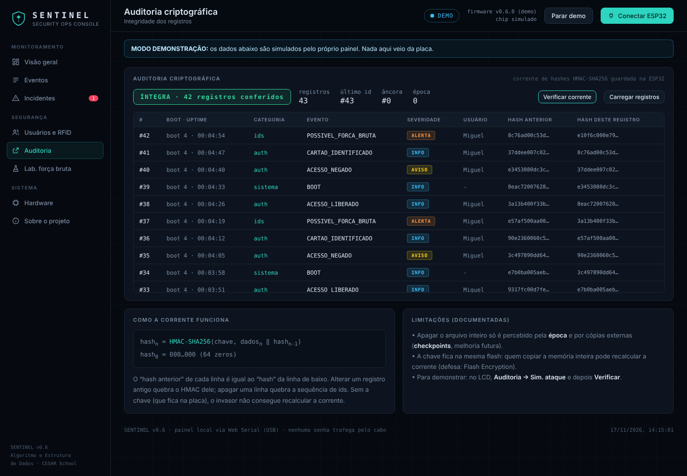
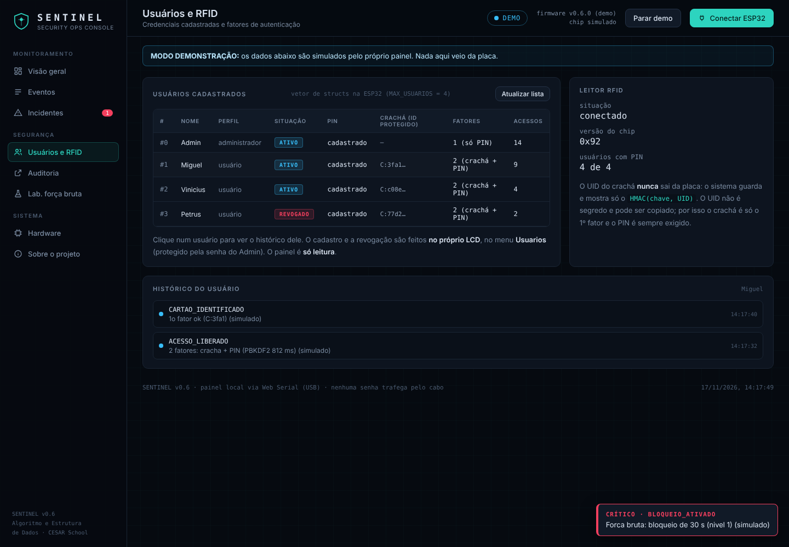
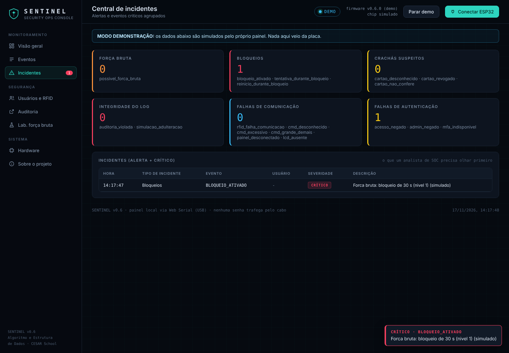
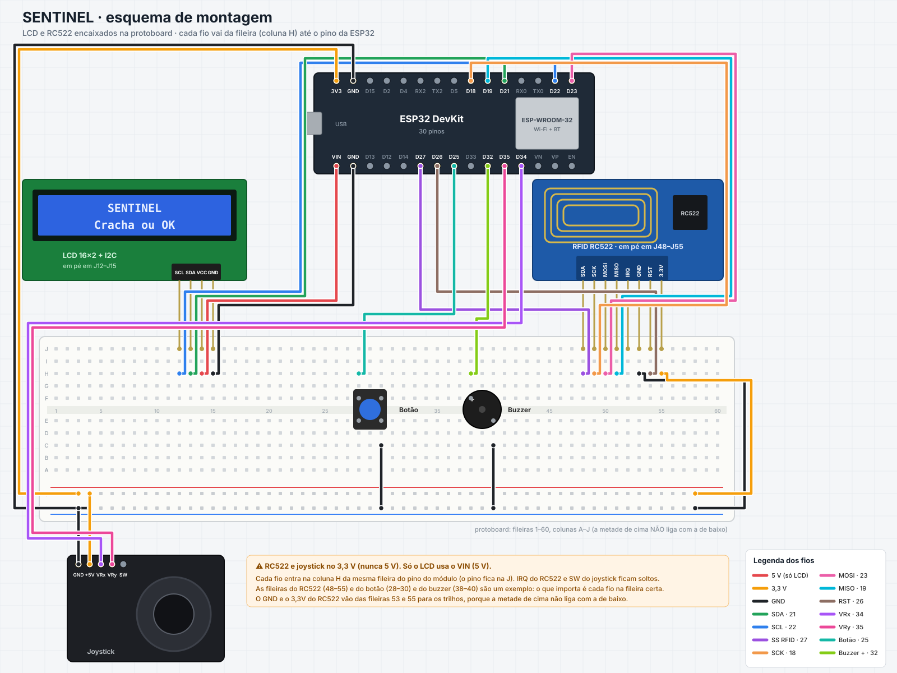

<div align="center">

# 🛡️ SENTINEL

### Smart Embedded Network Threat and Intrusion Logging System

**Controle de acesso com ESP32 que une segurança física e digital**
crachá RFID + PIN · detecção de força bruta · auditoria criptográfica · painel SOC


Projeto acadêmico · **Algoritmo e Estrutura de Dados** · CESAR School · 2026 · Prof. Fernando


</div>

---

## 📑 Sumário
- [O problema](#-o-problema)
- [O que o SENTINEL faz](#-o-que-o-sentinel-faz)
- [Como funciona](#-como-funciona)
- [Algoritmos e estruturas de dados](#-algoritmos-e-estruturas-de-dados)
- [Painel SOC](#️-painel-soc)
- [Hardware e ligações](#-hardware-e-ligações)
- [Como rodar](#-como-rodar)
- [Usando o sistema](#-usando-o-sistema)
- [Roteiro de demonstração](#-roteiro-de-demonstração-5-minutos)
- [Problemas comuns](#-problemas-comuns)
- [Estrutura do repositório](#-estrutura-do-repositório)
- [Documentação](#-documentação)
- [Limitações](#️-limitações-documentadas-de-propósito)
- [Equipe](#-equipe)

---

## 🎯 O problema

Muitos controles de acesso confiam só no **número do cartão (UID)**, que pode ser copiado. Muitos também aceitam **tentativas de senha sem limite** e guardam **registros que qualquer um pode editar**. O SENTINEL mostra, na prática, esses três ataques (clonagem, força bruta e adulteração de logs) e as defesas contra cada um, documentando com honestidade o que o hardware **não** consegue proteger.

## ✨ O que o SENTINEL faz

| | Funcionalidade | Como |
|---|---|---|
| 🔐 | **Autenticação em dois fatores** | Crachá RFID (*algo que você tem*) + PIN (*algo que você sabe*) |
| 🧂 | **Senha protegida** | Nunca guardada: só **PBKDF2-HMAC-SHA256** com 10.000 iterações e *salt* aleatório |
| 🚨 | **Detecção de força bruta (IDS)** | Alerta na 3ª falha e bloqueio na 5ª, com tempo progressivo de 30 s → 60 s → 120 s… até 15 min |
| 🔁 | **Bloqueio à prova de reinício** | O estado fica na memória permanente (NVS). Desligar a placa **não** libera o acesso |
| ⛓️ | **Auditoria criptográfica** | Cada evento carrega o hash do anterior (HMAC-SHA256); alterar ou apagar um registro é detectado |
| 👥 | **Gestão de usuários** | Até 4 pessoas com PIN e crachá próprios; cadastro e revogação no LCD, protegidos pela senha do Admin |
| 🕘 | **Histórico** | Os últimos 10 eventos numa fila circular, navegáveis no LCD |
| 🖥️ | **Painel SOC** | 8 telas no navegador, ao vivo pelo cabo USB, incluindo um **laboratório de força bruta** |

## 🔄 Como funciona



1. O usuário aproxima o crachá. A placa calcula um **id protegido** (`HMAC(chave, UID)`), sem nunca guardar o UID.
2. Uma **busca linear** no vetor de usuários encontra o dono do crachá.
3. O LCD pede o PIN, que é digitado com o joystick. Cada posição começa num número sorteado, para ninguém descobrir a senha contando os movimentos.
4. O PIN passa pelo **PBKDF2** e é comparado com o hash salvo, usando uma comparação de tempo constante.
5. O resultado vai para o LCD, para a **auditoria encadeada** e para o **painel**. As falhas alimentam o **IDS**.

Mais fluxogramas em [`docs/08_fluxogramas.md`](docs/08_fluxogramas.md): visão geral, IDS/bloqueio, auditoria e arquitetura.

## 🧠 Algoritmos e estruturas de dados

| Conceito | Onde está no código | Complexidade |
|---|---|---|
| **Máquina de estados** (enum + switch) | `firmware/SENTINEL/SENTINEL.ino` | — |
| **Vetor de structs** (usuários) | `user_manager.cpp` | acesso O(1) |
| **Busca linear** (dono do crachá) | `usuarioBuscarPorCartao()` | O(n) |
| **Fila circular** (histórico) | `historico.cpp` | inserção e leitura O(1) |
| **Encadeamento por hash** (auditoria) | `event_logger.cpp` | verificação O(n) |
| **Busca exaustiva** (força bruta) | Laboratório do painel | **O(10ⁿ)** |
| Funções de hash criptográficas | `crypto_manager.cpp` (PBKDF2, HMAC) | O(iterações) |

> O PBKDF2 foi implementado passo a passo sobre o HMAC do mbedTLS e **conferido contra o `hashlib` do Python**, incluindo o vetor de teste oficial (`password`/`salt`/4096 → `c5e478d5…`).

## 🖥️ Painel SOC

Uma página HTML única que conversa com a ESP32 pelo **cabo USB** (Web Serial API). Ela não precisa de Wi-Fi, servidor ou instalação.

| Tela | O que mostra |
|---|---|
| **Visão geral** | Estado do sistema, acessos liberados e negados, espelho do LCD, joystick ao vivo, atividade por minuto |
| **Eventos** | Linha do tempo com filtros por severidade, categoria e usuário; exportação para CSV |
| **Incidentes** | Força bruta, bloqueios, crachás suspeitos, integridade e falhas de comunicação |
| **Usuários e RFID** | Quem tem PIN e crachá, fatores de autenticação, histórico por pessoa |
| **Auditoria** | Corrente de hashes, verificação e o registro adulterado destacado em vermelho |
| **Lab. força bruta** | Tempo de ataque em 4 cenários, gráfico exponencial e simulação com as regras reais do firmware |
| **Hardware** | Módulos, mapa de pinos e console serial |
| **Sobre** | Arquitetura, equipe e conceitos |

<table>
<tr>
<td></td>
<td></td>
</tr>
<tr>
<td align="center"><b>Laboratório de força bruta</b></td>
<td align="center"><b>Auditoria: log violado detectado</b></td>
</tr>
<tr>
<td></td>
<td></td>
</tr>
<tr>
<td align="center"><b>Usuários e RFID</b></td>
<td align="center"><b>Central de incidentes</b></td>
</tr>
</table>

> Os prints acima são do **modo demo** (dados simulados, indicado no próprio painel).
> O painel é **só leitura**: nenhum comando pelo cabo altera senhas, usuários ou configurações, e nenhuma senha trafega pelo USB.

## 🔌 Hardware e ligações



> Versão vetorial (dá para dar zoom sem perder qualidade): [`docs/img/esquema_montagem.svg`](docs/img/esquema_montagem.svg) · Circuito para simular no **Wokwi**: [`simulacao/diagram.json`](simulacao/diagram.json)

| Componente | Sinal → GPIO da ESP32 | Alimentação |
|---|---|---|
| **LCD 16x2 I2C** | SDA → 21 · SCL → 22 | **5 V** (VIN) |
| **Joystick** | VRx → 34 · VRy → 35 | **3,3 V** |
| **Botão** | → 25 (pull-up interno) e GND | — |
| **RFID RC522** | SDA → 27 · SCK → 18 · MOSI → 23 · MISO → 19 · RST → 26 | **3,3 V** (nunca 5 V) |

- O firmware **funciona sem o RFID**: ele detecta sozinho se o leitor está ligado, inclusive se for plugado depois.
- Os LEDs do projeto original foram substituídos por avisos no LCD: ícones e a luz de fundo piscando.
- Detalhes em [`docs/01_hardware_e_gpios.md`](docs/01_hardware_e_gpios.md) e [`docs/09_rfid.md`](docs/09_rfid.md).

## 🚀 Como rodar

### Firmware
1. Instale a **[Arduino IDE 2.x](https://www.arduino.cc/en/software)**.
2. Em **Gerenciador de Placas**, instale **esp32 by Espressif Systems** (3.x).
3. Em **Gerenciador de Bibliotecas**, instale:
   - **LiquidCrystal I2C** (Frank de Brabander)
   - **MFRC522** (GithubCommunity). ⚠️ É obrigatória, mesmo sem o leitor ligado.
4. Abra `firmware/SENTINEL/SENTINEL.ino`. As outras abas abrem sozinhas.
5. Selecione **ESP32 Dev Module** e a porta COM, e clique em **Carregar**.
6. Se o endereço do seu LCD não for `0x27`, ajuste `LCD_I2C_ADDR` em `config.h` (descubra com `tests/hardware/05_i2c_scanner`).

### Painel
1. **Feche a Arduino IDE.** Ela segura a porta USB.
2. Abra `painel/index.html` no **Google Chrome** ou no **Microsoft Edge**.
   - Ou acesse pelo GitHub Pages, se estiver ativado: `https://miguelcavalcantii.github.io/projeto-c/painel/`
3. Clique em **Conectar ESP32** e escolha a porta (CP210x, CH340...).
4. Sem a placa, clique em **Modo demo** para ver o painel com dados simulados.

## 🎮 Usando o sistema

**Controles**

| Ação | Controle |
|---|---|
| Navegar / mudar o dígito | Joystick ▲ ▼ |
| Apagar o último dígito / voltar | Joystick ◀ |
| Confirmar | Botão (aperto curto) |
| Cancelar / voltar | Botão (segurar ~1 s) |

**Primeiro uso:** o LCD pede para criar a **senha do Admin** (digitada duas vezes).

**Menu principal:** `Entrar` · `Historico` · `Usuarios` · `Auditoria` · `Status` · `Alertas` · `Sobre` · `Voltar`

**Cadastrar um crachá:** `Usuarios` → senha do Admin → escolha a pessoa → `Definir PIN` → `Cad. cartao` → aproxime o crachá.
Os nomes dos usuários ficam em `config.h` (`NOME_USUARIO_0` a `NOME_USUARIO_3`); o usuário 0 é sempre o Admin.

## 🎬 Roteiro de demonstração (5 minutos)

1. **Autenticação:** aproximar o crachá, digitar o PIN e mostrar **ACESSO LIBERADO**, com o evento "2 fatores" no painel.
2. **Força bruta:** errar 5 vezes, chegar ao **SIST. BLOQUEADO 00:30** e mostrar a faixa vermelha no painel.
3. **Reiniciar para burlar:** apertar **EN/RST** e mostrar que a placa **volta bloqueada** (`REINICIO_DURANTE_BLOQUEIO`).
4. **Ataque ao log:** `Auditoria → Sim. ataque → Verificar` mostra **LOG VIOLADO**, com o registro destacado no painel.
5. **Complexidade:** no Laboratório, mudar de 4 para 6 dígitos e mostrar o tempo crescendo **×100** (O(10ⁿ)).

## 🧰 Problemas comuns

| Sintoma | Solução |
|---|---|
| `MFRC522.h: No such file or directory` | Instale a biblioteca **MFRC522** (GithubCommunity) |
| O painel fica em **CONECTANDO** | Aperte **EN/RST** na placa; confira o console na página **Hardware** |
| O painel não encontra a porta | Feche a Arduino IDE inteira e use Chrome ou Edge |
| O LCD acende mas fica sem texto | Gire o potenciômetro azul (contraste) ou ajuste `LCD_I2C_ADDR` |
| O menu "anda sozinho" | O joystick está sem alimentação: confira se o trilho + vem do **3V3** |
| O botão é lido como sempre apertado | Use pernas em **diagonal** e não deixe resistor no botão |
| O crachá não é lido | Pode ser de 125 kHz (o RC522 só lê 13,56 MHz); use o cartão do kit |
| Para apagar todas as senhas | IDE → *Erase All Flash Before Sketch Upload* → Enabled → gravar de novo |

## 📂 Estrutura do repositório

```
projeto-c/
├── firmware/SENTINEL/           firmware (Arduino IDE)
│   ├── SENTINEL.ino             variáveis, setup(), loop() e máquina de estados
│   ├── fluxo_cartao.ino         abas: crachá (MFA)
│   ├── fluxo_senha.ino                 senha (cadastro e verificação)
│   ├── menus.ino                       o que cada tela faz
│   ├── telas.ino                       desenho das telas no LCD
│   ├── config.h                 pinos e nomes dos usuários
│   ├── security_config.h        limites de segurança
│   ├── authentication.*         PIN por usuário (PBKDF2 + salt na NVS)
│   ├── crypto_manager.*         PBKDF2, HMAC-SHA256, comparação segura
│   ├── security_engine.*        IDS e bloqueio progressivo persistente
│   ├── event_logger.*           auditoria encadeada (LittleFS)
│   ├── user_manager.*           vetor de usuários + busca linear
│   ├── historico.*              fila circular
│   ├── rfid_manager.*           leitor RC522 (autodetecção)
│   ├── display_manager.*        LCD e ícones
│   ├── input_manager.*          joystick e botão (debounce)
│   ├── feedback_manager.*       avisos (substituem os LEDs)
│   └── telemetry_manager.*      protocolo JSON com o painel
├── painel/index.html            painel SOC (um único arquivo)
├── simulacao/                   circuito para o Wokwi (diagram.json + libraries.txt)
├── tests/hardware/              testes de bancada de cada componente
└── docs/                        documentação, fluxogramas (Mermaid + PNG) e imagens
```

## 📚 Documentação

| # | Documento | Conteúdo |
|---|---|---|
| 01 | [Hardware e GPIOs](docs/01_hardware_e_gpios.md) | Ligações, nível lógico, conflitos de pinos |
| 02 | [Arquitetura](docs/02_arquitetura.md) | Camadas, decisões, dependências |
| 03 | [Testes dos componentes](docs/03_plano_testes_componentes.md) | Roteiro de bancada |
| 04 | [Riscos do RC522](docs/04_riscos_e_limitacoes_rc522.md) | Por que o UID não é seguro |
| — | [Histórico de versões](CHANGELOG.md) | O que mudou em cada versão |
| 05 | [Painel e protocolo](docs/05_painel_pc.md) | Web Serial e mensagens JSON |
| 06 | [Senha (PBKDF2)](docs/06_etapa3_senha.md) | Hash, salt, testes |
| 07 | [IDS e auditoria](docs/07_etapas4e5.md) | Bloqueio progressivo, corrente HMAC |
| 08 | [Fluxogramas](docs/08_fluxogramas.md) | 5 diagramas do sistema |
| 09 | [RFID](docs/09_rfid.md) | Ligação, cadastro de crachá, limitações |
| 10 | [Simulação (Wokwi)](docs/10_simulacao.md) | Circuito em código (`simulacao/diagram.json`) e simulação no navegador |

## ⚠️ Limitações (documentadas de propósito)

- **O UID do RFID pode ser copiado.** Por isso o crachá é só o 1º fator e o PIN é sempre exigido. Com o leitor desligado, quem tem crachá cadastrado **não** entra ("falha fechada").
- **O PIN de 4 dígitos tem 10.000 combinações.** Quem copiar a memória flash pode testá-las offline. Contra quem está na frente do teclado, a defesa é o bloqueio; contra a cópia da flash, seria a *Flash Encryption* (melhoria futura).
- **A corrente de hashes detecta alterações, mas não impede apagar o arquivo inteiro.** A solução seriam checkpoints externos (melhoria futura).
- **A chave do HMAC fica na mesma flash** que o log.
- **Não há relógio (RTC):** os eventos usam "nº do boot + tempo ligado".

## 📈 Status

| Parte | Situação |
|---|---|
| Interface LCD, joystick, botão e painel USB | ✅ Testado na placa |
| Senha com PBKDF2 + salt | ✅ Testado na placa |
| IDS, bloqueio progressivo e auditoria | ✅ Testado pela equipe na placa (17/11) |
| Usuários, histórico e painel com 8 telas | ✅ Testado pela equipe na placa (17/11) |
| Leitor RFID RC522 | ⏳ Firmware pronto e simulado; ligação na placa pendente |

**Melhorias futuras:** checkpoints da auditoria fora da placa, RTC DS3231 para data e hora reais, Flash Encryption e cartões com criptografia de verdade (MIFARE DESFire + PN532).

## 👥 Equipe

| | Integrante |
|---|---|
| 👤 | **Vinicius Britto** |
| 👤 | **Petrus Vieira** |
| 👤 | **Miguel Cavalcanti** · [@miguelcavalcantii](https://github.com/miguelcavalcantii) |

Projeto desenvolvido para a disciplina **Algoritmo e Estrutura de Dados**, CESAR School, 2026, Prof. Fernando.

## 📄 Licença

Distribuído sob a licença [MIT](LICENSE).
