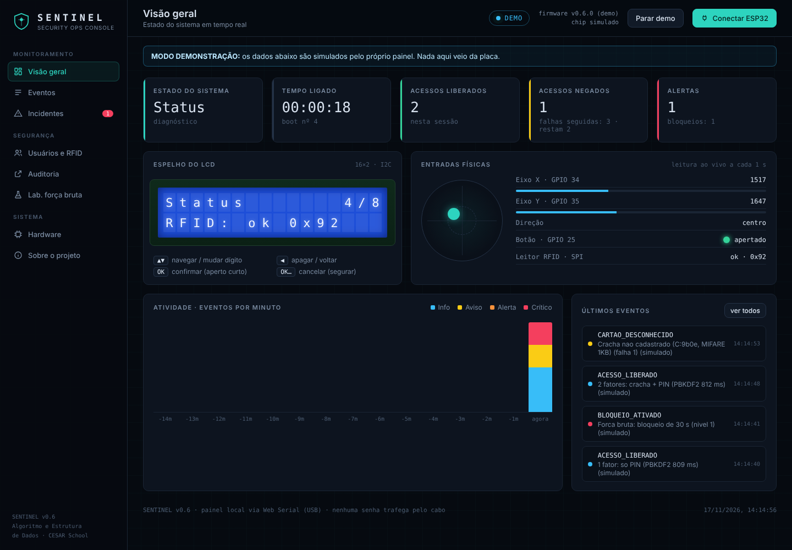

# 🛡️ SENTINEL

**Smart Embedded Network Threat and Intrusion Logging System**

Controle de acesso com **ESP32** que une segurança física e digital: crachá RFID + PIN (autenticação em dois fatores), detecção de força bruta com bloqueio progressivo, auditoria com corrente de hashes HMAC-SHA256 e um **painel de monitoramento no estilo SOC** que roda no computador.

> Projeto acadêmico com ESP32 da disciplina **Algoritmo e Estrutura de Dados**, CESAR School (2026) · Prof. Fernando.



## 👥 Equipe
- Vinicius Britto
- Petrus Vieira
- Miguel Cavalcanti

## ✨ Funcionalidades

| Área | O que faz |
|---|---|
| **Interface física** | LCD 16x2 com ícones próprios, joystick e botão, tudo controlado por uma máquina de estados (sem `delay()` travando o sistema) |
| **Autenticação** | Crachá RFID (1º fator) + PIN (2º fator). O PIN é guardado só como **PBKDF2-HMAC-SHA256 com salt**, nunca em texto puro |
| **Usuários** | Até 4 usuários com PIN e crachá próprios; cadastro e revogação pelo LCD (área protegida pela senha do Admin) |
| **IDS / força bruta** | Alerta na 3ª falha e bloqueio na 5ª, com tempo progressivo (30 s → 60 s → … → 15 min). **Reiniciar a placa não libera o bloqueio** |
| **Auditoria** | Cada evento é gravado com o hash do anterior (HMAC-SHA256): qualquer alteração ou remoção no meio do log é detectada |
| **Painel SOC** | 8 telas no navegador: visão geral, eventos, incidentes, usuários, auditoria, **laboratório de força bruta**, hardware e sobre |

## 🧠 Algoritmos e estruturas de dados

| Conceito | Onde está |
|---|---|
| Máquina de estados (enum + switch) | `firmware/SENTINEL/SENTINEL.ino` |
| Vetor de structs + **busca linear O(n)** | `user_manager.cpp`: achar o dono de um crachá |
| **Fila circular** (inserção O(1)) | `historico.cpp`: últimos 10 eventos na tela "Histórico" |
| Encadeamento por hash | `event_logger.cpp`: cada registro aponta para o anterior |
| **Busca exaustiva O(10ⁿ)** | Laboratório de força bruta no painel |
| Funções de hash criptográficas (PBKDF2, HMAC) | `crypto_manager.cpp` |


## 🔌 Hardware

| Componente | Pinos (ESP32) |
|---|---|
| LCD 16x2 I2C | SDA 21 · SCL 22 · VCC **5 V** |
| Joystick | VRx 34 · VRy 35 · VCC **3,3 V** |
| Botão | GPIO 25 (pull-up interno) |
| RFID RC522 | SS 27 · SCK 18 · MOSI 23 · MISO 19 · RST 26 · VCC **3,3 V** |

Detalhes em [`docs/01_hardware_e_gpios.md`](docs/01_hardware_e_gpios.md) e [`docs/09_rfid.md`](docs/09_rfid.md).

## 🚀 Como rodar

1. Instale a **Arduino IDE 2.x** e a placa **esp32 by Espressif Systems** (versão 3.x).
2. Instale as bibliotecas **LiquidCrystal I2C** (Frank de Brabander) e **MFRC522** (GithubCommunity).
3. Abra `firmware/SENTINEL/SENTINEL.ino`. As outras abas aparecem sozinhas. Selecione **ESP32 Dev Module** e grave.
4. No primeiro uso, o LCD pede para criar a **senha do Admin**.
5. **Feche a Arduino IDE**, abra `painel/index.html` no **Chrome** ou no **Edge** e clique em **Conectar ESP32**.
   Sem a placa, use o botão **Modo demo**.

## 📂 Estrutura

```
SENTINEL/
├── firmware/SENTINEL/     firmware (Arduino IDE): .ino em abas + módulos .h/.cpp
├── painel/index.html      painel SOC (Web Serial, um único arquivo)
├── tests/hardware/        sketches de teste de cada componente
└── docs/                  documentação técnica, fluxogramas e roteiros de teste
```

## 📚 Documentação

| Documento | Conteúdo |
|---|---|
| [01 – Hardware e GPIOs](docs/01_hardware_e_gpios.md) | Ligações, nível lógico, conflitos de pinos |
| [02 – Arquitetura](docs/02_arquitetura.md) | Decisões, dependências, camadas |
| [03 – Testes dos componentes](docs/03_plano_testes_componentes.md) | Roteiro de bancada |
| [04 – Riscos e limitações do RC522](docs/04_riscos_e_limitacoes_rc522.md) | Por que o UID não é seguro |
| [05 – Painel e protocolo](docs/05_painel_pc.md) | Web Serial, mensagens JSON |
| [06 – Senha (PBKDF2)](docs/06_etapa3_senha.md) | Hash, salt, testes |
| [07 – IDS e auditoria](docs/07_etapas4e5.md) | Bloqueio progressivo, corrente HMAC |
| [08 – Fluxogramas](docs/08_fluxogramas.md) | Diagramas do sistema |
| [09 – RFID](docs/09_rfid.md) | Ligação, cadastro de crachá, limitações |

## ⚠️ Limitações (documentadas de propósito)
- **O UID do RFID pode ser copiado.** Por isso o crachá é só o 1º fator e o PIN é sempre exigido.
- **PIN de 4 dígitos = 10.000 combinações.** Quem copiar a flash pode testar todas offline. A defesa contra quem está na frente do teclado é o bloqueio; contra a cópia da flash seria a Flash Encryption (melhoria futura).
- **A corrente de hashes detecta alterações, mas não impede apagar o arquivo inteiro.** A solução seriam checkpoints externos (melhoria futura).
- **Sem relógio (RTC):** os eventos usam "nº do boot + tempo ligado".

## 📈 Status

| Etapa | Situação |
|---|---|
| Interface LCD + joystick + painel USB | ✅ Validado na placa |
| Senha com PBKDF2 + salt | ✅ Validado na placa |
| IDS + bloqueio + auditoria | ⏳ Simulado no PC, teste na placa pendente |
| Usuários + RFID + histórico + painel com 8 telas | ⏳ Simulado no PC, teste na placa pendente |

## 📄 Licença
[MIT](LICENSE)
