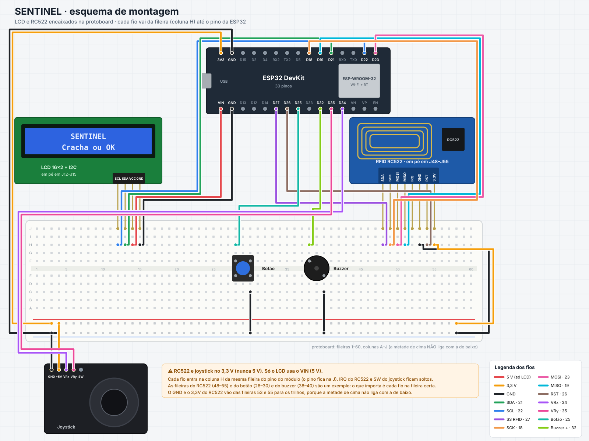

# 01 – Hardware, mapeamento de GPIOs e montagem

> Status: **proposto na Etapa 1, ainda não validado em bancada.** A coluna "Validado" é preenchida pelo grupo depois de cada teste.

## Esquema de montagem

## 1. Componentes

| Componente | Situação | Alimentação | Observação |
|---|---|---|---|
| ESP32-WROOM-32 (placa ANTS MAKE AM-032, com display embutido) | Em mãos | USB 5 V → regulador 3,3 V | Lógica de 3,3 V. **Os GPIOs não são tolerantes a 5 V.** |
| RFID RC522 (MFRC522) + cartão/chaveiro | Em mãos | **3,3 V** | 5 V pode danificar o módulo |
| LCD 16x2 com adaptador I2C (PCF8574) | Em mãos | **5 V** | Ver a seção 4 (nível lógico) |
| Joystick analógico (KY-023 ou similar) | Em mãos | **3,3 V** | Em 5 V, a saída passa do limite do ADC |
| Botão (push button) | Em mãos | – | Usa o pull-up interno |
| LED verde + resistor de 220–330 Ω | Em mãos | – | |
| LED vermelho + resistor de 220–330 Ω | Em mãos | – | |
| Buzzer, RTC DS3231, microSD, conversor de nível, PN532 | **Não temos** | – | Opcionais/futuros. Nada no firmware depende deles. |

## 2. Tabela de GPIOs

| Função | GPIO | Direção | Por que esse pino | Validado |
|---|---|---|---|---|
| RC522 SDA/SS | 27 | Saída | GPIO livre, sem função de boot | ☐ |
| RC522 SCK | 18 | Saída | SPI padrão (VSPI) | ☐ |
| RC522 MOSI | 23 | Saída | SPI padrão (VSPI) | ☐ |
| RC522 MISO | 19 | Entrada | SPI padrão (VSPI) | ☐ |
| RC522 RST | 26 | Saída | GPIO livre | ☐ |
| LCD SDA | 21 | E/S | I2C padrão | ☐ |
| LCD SCL | 22 | Saída | I2C padrão | ☐ |
| Joystick VRx | 34 | Entrada analógica | Só entrada, ADC1 (funciona com Wi-Fi ligado) | ☐ |
| Joystick VRy | 35 | Entrada analógica | Só entrada, ADC1 | ☐ |
| Botão | 25 | Entrada (INPUT_PULLUP) | Tem pull-up interno (o 34/35 não tem) | ☐ |
| Buzzer (perna +) | 32 | Saída (PWM/tone) | GPIO livre, sem função de boot; perna − no GND | ☐ |
| ~~LEDs~~ (removidos; função passou para o LCD e o buzzer) | 33 (livre) | – | – | – |

### Conferência de conflitos (feita na Etapa 1)

- **Pinos de boot (strapping) 0, 2, 5, 12 e 15:** nenhum está em uso. O GPIO 12 é o mais perigoso: se estiver em nível alto no boot, a ESP32 pode não ligar.
- **GPIOs 6 a 11:** ligados à memória flash interna. Nunca usar.
- **ADC2 (GPIOs 0, 2, 4, 12–15, 25–27):** para de funcionar quando o Wi-Fi está ligado. Por isso o joystick está no ADC1 (34/35). O 25, o 26 e o 27 estão sendo usados só como digitais, o que não tem problema.
- **SPI e I2C** estão em barramentos diferentes, então não há conflito.
- **Mudança em relação à montagem antiga (projeto de força bruta):** lá o LED vermelho estava no GPIO 2, o verde no 19 e o botão no 18. O 18 e o 19 agora são do RFID, e o GPIO 2 é pino de boot. **É preciso religar:** verde 19 → 32, vermelho 2 → 33 e botão 18 → 25.
- **⚠ Display embutido da placa AM-032:** ainda não sabemos em quais pinos ele está ligado. Se ele usar o 21/22 (I2C), tudo bem: pode dividir o barramento com o LCD, porque os endereços são diferentes (OLED costuma ser 0x3C e LCD 0x27/0x3F). Se usar algum dos pinos da tabela de outra forma, temos um conflito. **O teste 05 (scanner I2C) ajuda a descobrir.**

## 2.1 Montagem atual (v0.2): só cabos macho-fêmea, sem LEDs e sem RFID

Temos 13 cabos macho-fêmea e nenhum fêmea-fêmea. Por isso, o LCD e o joystick ficam **encaixados na protoboard**, e cada fio vai da ESP (ponta fêmea no pino) até a fileira do componente (ponta macho). O botão tem uma perna na mesma fileira do GND do joystick, então os dois compartilham o GND.

| Fio | ESP32 | Componente |
|---|---|---|
| 1 | GND | LCD GND |
| 2 | VIN/5V | LCD VCC |
| 3 | GPIO 21 | LCD SDA |
| 4 | GPIO 22 | LCD SCL |
| 5 | GND (outro pino) | Joystick GND + uma perna do botão |
| 6 | 3V3 | Joystick +5V (ligado em 3,3 V de propósito) |
| 7 | GPIO 34 | Joystick VRx |
| 8 | GPIO 35 | Joystick VRy |
| 9 | GPIO 25 | Outra perna do botão |

Os LEDs foram substituídos por feedback no LCD: ícone de "certo" com luz fixa (antigo LED verde) e ícone de "X" com a luz de fundo piscando (antigo LED vermelho). O RFID entra na última etapa, combinado com o professor.

## 3. Ligações, fio por fio (montagem completa futura)

**Trilhos da protoboard:** ligue o **3V3** da ESP32 em um trilho (+3,3 V) e o **GND** no trilho azul. Se for alimentar o LCD, use o pino **5V/VIN** (5 V do USB) em um ponto separado. **Nunca junte o trilho de 3,3 V com o de 5 V.** Todos os GNDs são comuns.

**RC522:** SDA→27, SCK→18, MOSI→23, MISO→19, IRQ→(sem ligação), GND→GND, RST→26, 3.3V→3V3.

**LCD I2C:** GND→GND, VCC→5V, SDA→21, SCL→22 (leia a seção 4 antes de ligar).

**Joystick:** GND→GND, +5V (nome impresso no módulo)→**3V3**, VRx→34, VRy→35, SW→sem ligação por enquanto (pode virar um segundo botão no futuro: GPIO 4 ou 13).

**Botão:** uma perna no GPIO 25 e a outra (do lado oposto) no GND. Não precisa de resistor.

**Buzzer:** perna **+** (a mais comprida, ou o lado marcado com "+") no GPIO 32 e a perna **−** no GND. Funciona com buzzer **passivo** ou **ativo**; se for ativo e o som sair "rouco", mude `BUZZER_ATIVO` para `true` no `config.h`. Teste antes com `tests/hardware/09_buzzer`.

**LEDs:** GPIO → resistor de 220–330 Ω → perna longa (anodo); perna curta (catodo) → GND. Com 3,3 V e 220 Ω a corrente fica em torno de 5–7 mA, bem abaixo do limite do GPIO.

## 4. Atenção: nível lógico do LCD (5 V × 3,3 V)

O adaptador PCF8574 normalmente tem **resistores de pull-up de 4,7 kΩ ligados ao VCC**. Com o LCD alimentado em 5 V, as linhas SDA/SCL ficam em **5 V**, e a ESP32 é especificada para no máximo ~3,6 V nos GPIOs.

**Como verificar (antes de ligar na ESP32):**
1. Alimente só o LCD em 5 V e GND, com o SDA e o SCL **desconectados** da ESP32.
2. Com o multímetro, meça a tensão entre o SDA e o GND, e depois entre o SCL e o GND.
3. Se der **~5 V**, existe pull-up para 5 V. Se der **~0 V ou flutuando**, não há pull-up.

**Se der 5 V, temos três opções (da mais correta para a menos):**
1. **Conversor de nível lógico bidirecional** (módulo de 4 canais com BSS138, barato). É a solução certa.
2. Remover os resistores de pull-up do adaptador e colocar 4,7 kΩ do SDA/SCL para o **3,3 V**. Isso funciona porque o PCF8574 reconhece ~3,3 V como nível alto com VCC de 5 V (limite de ~0,7×VCC = 3,5 V, então fica no limite: é preciso testar).
3. Ligar direto. Muita gente faz isso e "funciona", mas **fica fora da especificação** e pode estragar a ESP32 com o tempo. Não recomendamos e, se for feito, tem que ser documentado como risco.

Decisão do grupo: ☐ 1 ☐ 2 ☐ 3 — Tensão medida: SDA = ___ V, SCL = ___ V
