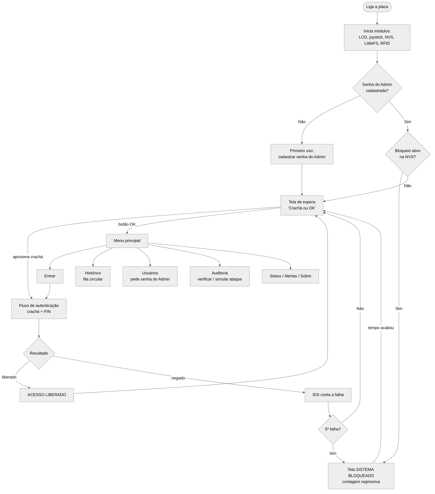
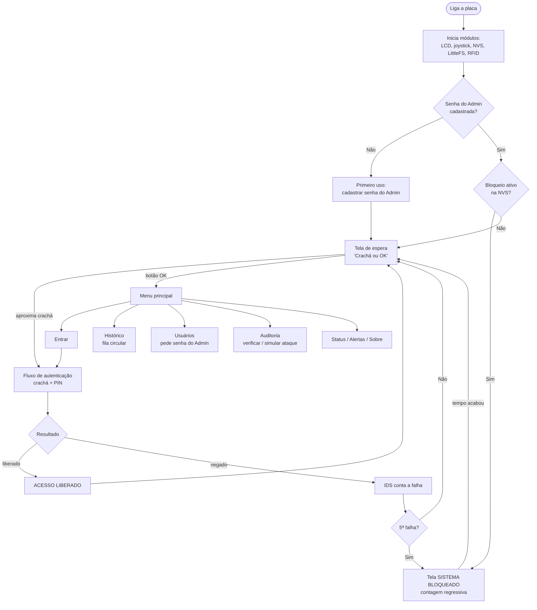
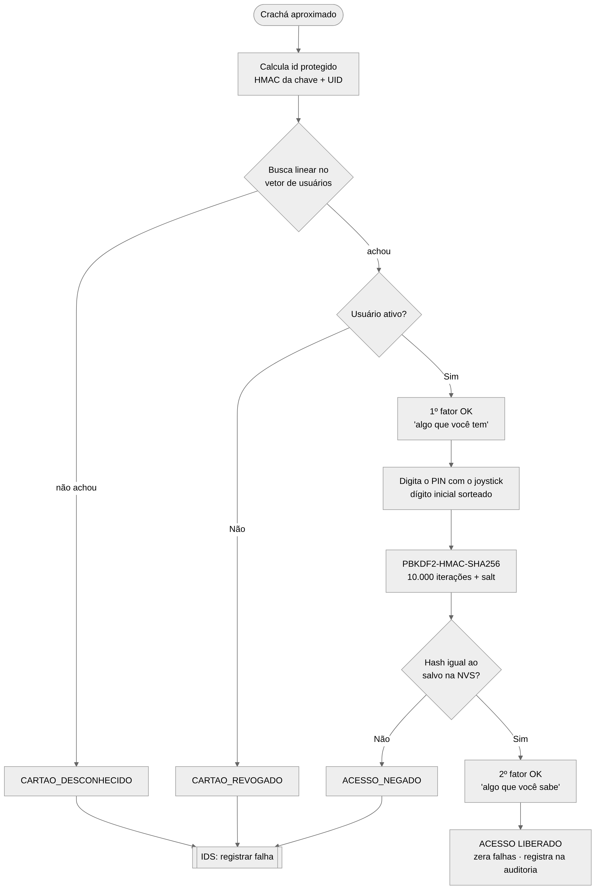
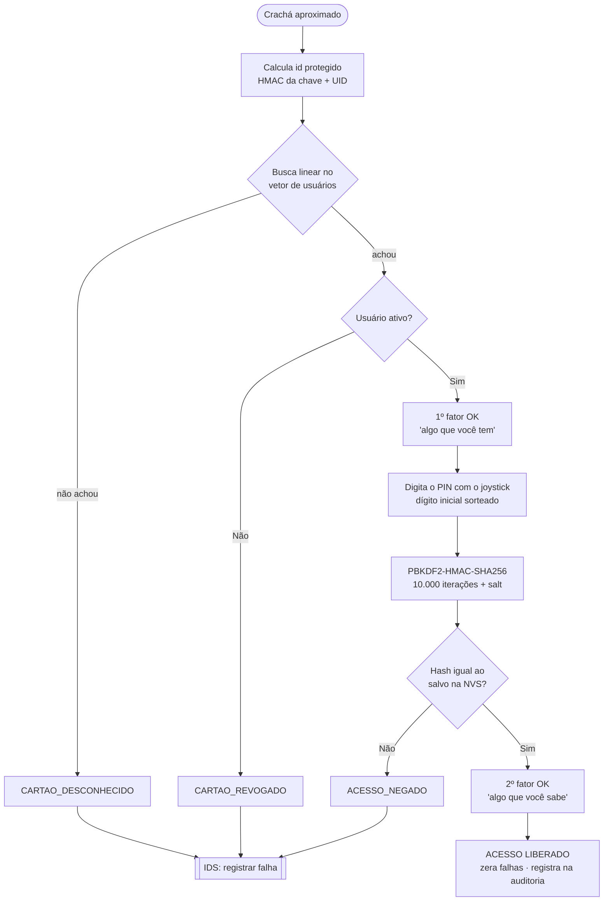
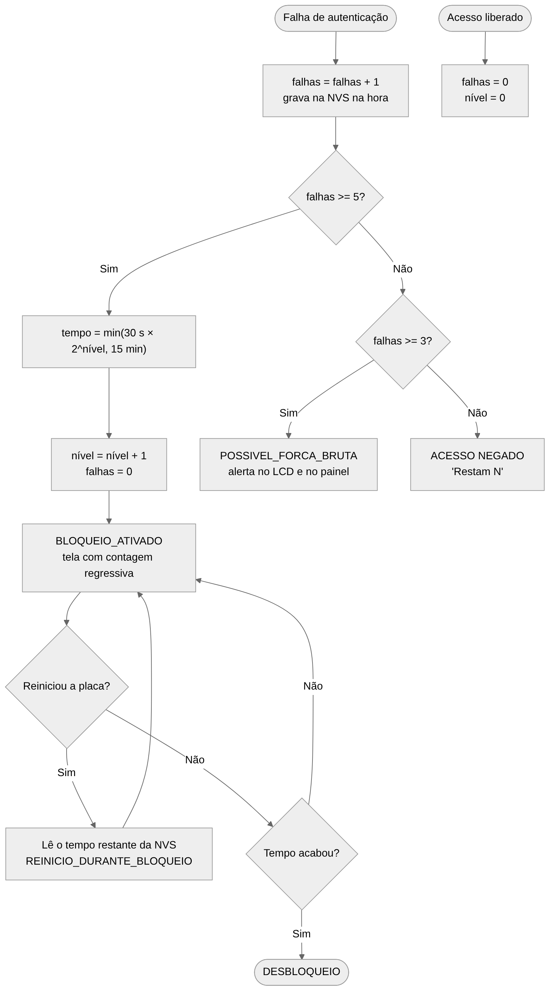
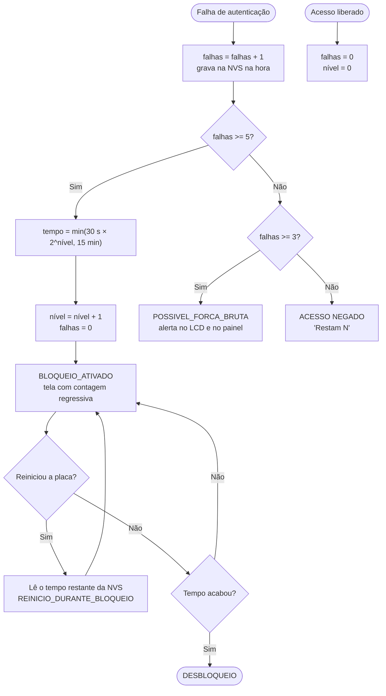
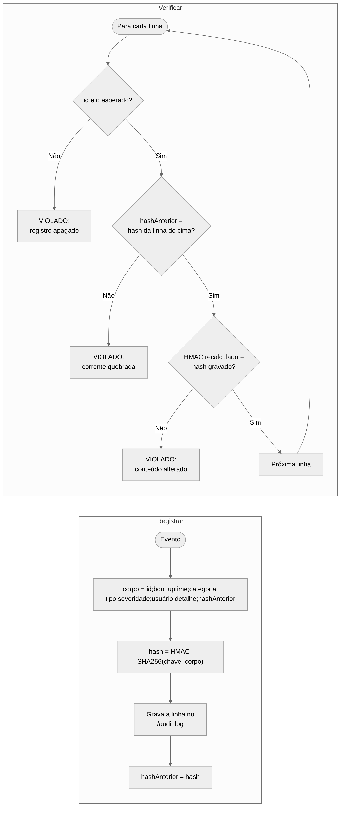
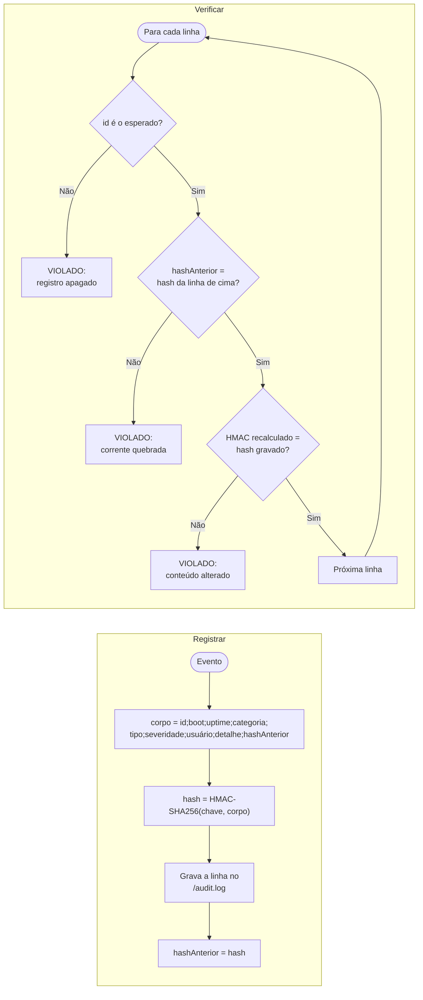
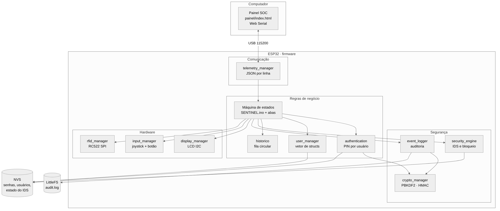

# 08 – Fluxogramas

Os diagramas abaixo são desenhados pelo próprio GitHub (Mermaid). As versões em imagem, para colocar nos slides, estão em `docs/img/`. Os arquivos-fonte ficam em `docs/fluxogramas/*.mmd`.

## 1. Visão geral do sistema

## 2. Autenticação em dois fatores (crachá + PIN)

## 3. Detecção de força bruta e bloqueio

## 4. Auditoria criptográfica (registrar e verificar)

## 5. Arquitetura (módulos e camadas)

A regra da arquitetura é que uma camada só usa as camadas de baixo. Por exemplo, a máquina de estados pede "tem cartão?" ao `rfid_manager`, mas o `rfid_manager` não sabe nada de senha.
